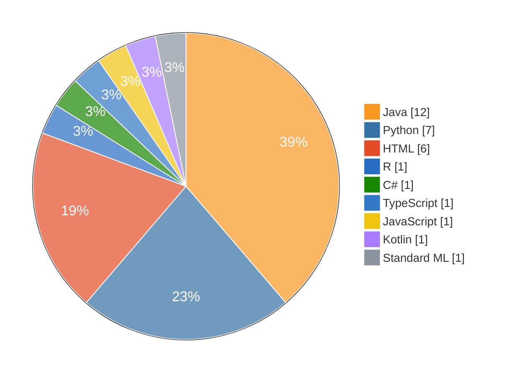
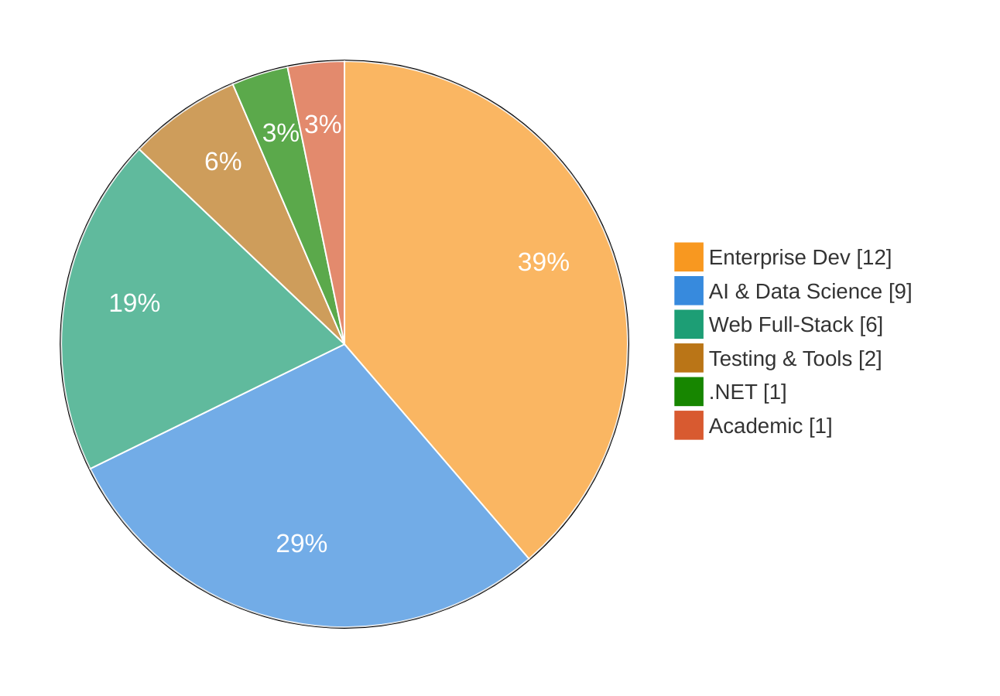

# Perikles Nikoules

**Military Officer — Technical Corps &nbsp;|&nbsp; Electrical & Computer Engineer &nbsp;|&nbsp; AI Researcher**

Officer by day, builder by passion — software and AI are my craft and my hobby.

 

---

## 👤 About Me

I am a **Military Officer in the Technical Corps** of the Hellenic Army with a strong academic foundation in **Electrical and Computer Engineering** from NTUA. I am currently pursuing an **MSc in Artificial Intelligence** at the University of Essex.

My work spans enterprise software development, full-stack web applications, data science, and technology project management — areas where engineering discipline and analytical thinking converge.

### 💼 Areas of Focus

- 🤖 **Artificial Intelligence & Machine Learning** — neural networks, deep learning, NLP, data science pipelines
- 🏗️ **Enterprise Software Development** — full-stack Java/Spring, REST APIs, microservices
- 🌐 **Web Development** — Angular/TypeScript frontend; Django, Flask, Spring Boot backend
- 📋 **Technology Leadership** — Agile methodologies, project coordination, systems architecture

---

## 🎓 Education

<table align="center">
<tr>
<td align="center" width="50%">

Machine learning, neural networks, NLP and data science applications *In progress*

</td>
<td align="center" width="50%">

Digital systems, telecommunications, software architecture and algorithms *Completed*

</td>
</tr>
</table>

---

## 🏆 Professional Certifications

---

## 📊 Repository Summary

### Primary language per repository

### Repositories by domain

| Domain | Primary language | Repos | Focus |
|:--|:--|:-:|:--|
| ☕ Enterprise Dev | Java | 12 | Spring Boot · Hibernate · REST APIs · Desktop GUI · Networking |
| 🤖 AI & Data Science | Python | 9 | PyTorch · TensorFlow · Pandas · NLP · Neural networks · Data analysis |
| 🌐 Web Full-Stack | Python / TypeScript | 6 | Django · Angular · Tailwind · PostgreSQL · REST APIs |
| 🔷 .NET Development | C# | 1 | ASP.NET · Desktop applications |
| 🧪 Testing & Tools | Java / Kotlin | 2 | Selenium WebDriver · Test automation · Utilities |
| 📚 Academic & Research | Multiple | 1 | NTUA projects · Multi-language implementations |

---

## 🛠️ Technical Skills

*Self-assessed levels.*

| Skill | Level | |
|:--|:--|:--|
| Java / Spring Boot | `████████` | Expert |
| SQL · MySQL · PostgreSQL | `████████` | Expert |
| HTML / CSS | `████████` | Expert |
| Git / GitHub | `████████` | Expert |
| Python · TensorFlow · PyTorch | `██████░░` | Advanced |
| C# · TypeScript · JavaScript | `██████░░` | Advanced |
| Angular · Django · Flask | `██████░░` | Advanced |
| Docker · Maven | `██████░░` | Advanced |
| R · C/C++ · Kotlin · Prolog · SML | `████░░░░` | Intermediate |
| CI/CD | `████░░░░` | Intermediate |

| | |
|:--|:--|
| **Languages** | Java · Python · C# · TypeScript · JavaScript · R · C/C++ · Prolog · SML · Kotlin |
| **Frontend** | HTML/CSS · Angular · Bootstrap · Tailwind CSS |
| **Backend** | Spring Boot · Hibernate/JPA · JAX-RS · Django · Flask |
| **Databases** | MySQL · PostgreSQL · SQL Server |
| **DevOps & Tools** | Git/GitHub · Docker · Maven · CI/CD |
| **AI & ML** | TensorFlow · PyTorch · Scikit-learn · Pandas · NumPy |
| **Testing** | Selenium |

---

## 🎯 Featured Projects

### 🤖 AI, Machine Learning & Data Science

| Project | Description | Stack |
|:--|:--|:--|
| [**from-plato-to-transformers**](https://github.com/nikouliciousp/from-plato-to-transformers) | Interactive philosophical journey through 5 experiments in neural networks, from ancient Greek philosophy to modern AI | HTML · MIT |
| [**ai104-sentiment-analysis**](https://github.com/nikouliciousp/ai104-sentiment-analysis) | MSc AI — sentiment analysis & topic classification | Python |
| [**AIPythonProjects**](https://github.com/nikouliciousp/AIPythonProjects) | Comprehensive AI & machine learning implementations | Python · PyTorch |
| [**AG701-Crime-Analysis-California**](https://github.com/nikouliciousp/AG701-Crime-Analysis-California) | Statistical analysis & visualisation — California crime dataset | R |
| [**nexus_energy_analysis**](https://github.com/nikouliciousp/nexus_energy_analysis) | Energy consumption analysis & prediction models | Python · ML |
| [**neurons_experiment**](https://github.com/nikouliciousp/neurons_experiment) | Neural network research and experimentation | HTML |
| [**relu_experiment**](https://github.com/nikouliciousp/relu_experiment) | Activation function research & deep learning experiments | HTML · MIT |
| [**Data-Probability-Statistics**](https://github.com/nikouliciousp/Data-Probability-Statistics) | Statistical analysis, probability, and data processing | HTML |
| [**IntroPython**](https://github.com/nikouliciousp/IntroPython) | Python fundamentals, OOP, and core programming concepts | Python |

<!--
TELCO (private repo added 2026-11-08) — add a row here once name/description are confirmed.
Note: a private repo link returns 404 for visitors, so list it without a link or make the repo public.
| **<telco-repo-name>** | <description> | <stack> |
-->

### ☕ Java & Enterprise Development

| Project | Description | Stack |
|:--|:--|:--|
| [**SchoolWebApp**](https://github.com/nikouliciousp/SchoolWebApp) | Full school management system with REST API and web interface | Java · Spring |
| [**SchoolJaxRsApp**](https://github.com/nikouliciousp/SchoolJaxRsApp) | RESTful API backend for school management | Java · JAX-RS |
| [**SchoolAppHibernate**](https://github.com/nikouliciousp/SchoolAppHibernate) | ORM-based persistence layer with JPA | Java · Hibernate |
| [**MavenSwingSchoolApp**](https://github.com/nikouliciousp/MavenSwingSchoolApp) | Desktop application with Maven build management | Java · Maven · Swing |
| [**SwingStudentsTeachersApp**](https://github.com/nikouliciousp/SwingStudentsTeachersApp) | School management desktop app — MVC pattern | Java · Swing |
| [**JavaSwingDemoProject**](https://github.com/nikouliciousp/JavaSwingDemoProject) | GUI desktop application with event-driven design | Java · Swing |
| [**JavaSwingWDemoProject**](https://github.com/nikouliciousp/JavaSwingWDemoProject) | Advanced desktop application with multi-window support | Java · Swing |
| [**NetProgramming**](https://github.com/nikouliciousp/NetProgramming) | Network programming in Java | Java |
| [**CodingJavaLab**](https://github.com/nikouliciousp/CodingJavaLab) | Algorithms, data structures, and programming exercises | Java |
| [**TestApp**](https://github.com/nikouliciousp/TestApp) | Java testing and demonstration applications | Java |
| [**SimpleDynamicWebApp**](https://github.com/nikouliciousp/SimpleDynamicWebApp) | Dynamic web application with Java backend | Java |
| [**FinalProject**](https://github.com/nikouliciousp/FinalProject) | University capstone integration project | Java |

### 🌐 Web Development — Full Stack

| Project | Description | Stack |
|:--|:--|:--|
| [**NewsProjectPython**](https://github.com/nikouliciousp/NewsProjectPython) | Full-stack news portal with REST API | Django · PostgreSQL |
| [**ProfilesAppDJango**](https://github.com/nikouliciousp/ProfilesAppDJango) | User profiles and authentication management system | Django |
| [**EBookAppDJango**](https://github.com/nikouliciousp/EBookAppDJango) | E-book platform and digital library management | Django · Python |
| [**IntroAngularTailwind**](https://github.com/nikouliciousp/IntroAngularTailwind) | Modern SPA with Angular and Tailwind CSS | Angular · Tailwind |
| [**IntroTypeScript**](https://github.com/nikouliciousp/IntroTypeScript) | Angular and TypeScript best practices | Angular · TypeScript |
| [**WebApp-Flex-Grid**](https://github.com/nikouliciousp/WebApp-Flex-Grid) | Responsive CSS layout — Flexbox and Grid | HTML5 · CSS3 |

### 🔷 .NET, Testing & Academic

| Project | Description | Stack |
|:--|:--|:--|
| [**CFHCSharpIntro**](https://github.com/nikouliciousp/CFHCSharpIntro) | C# programming fundamentals and OOP | C# · .NET |
| [**Selenium_Test**](https://github.com/nikouliciousp/Selenium_Test) | Automated browser testing framework | Selenium |
| [**swot**](https://github.com/nikouliciousp/swot) | Academic email domain identifier utility (fork of JetBrains/swot) | Kotlin |
| [**NTUA-Projects**](https://github.com/nikouliciousp/NTUA-Projects) | Academic projects from NTUA with multi-language implementations | Standard ML · Java · Python · C++ |

---

## 🎯 Current Focus

- 🤖 **Advanced AI & Deep Learning** — neural networks, NLP, computer vision (MSc at University of Essex)
- 📊 **Engineering Leadership** — Agile practices, team coordination, strategic planning & architecture
- 🎓 **Technical Mentoring** — system design, clean code, SOLID, design patterns

---

## 📞 Contact & Connect

*Build with discipline. Learn with curiosity. Improve continuously.*

**Last updated: November 2026**

