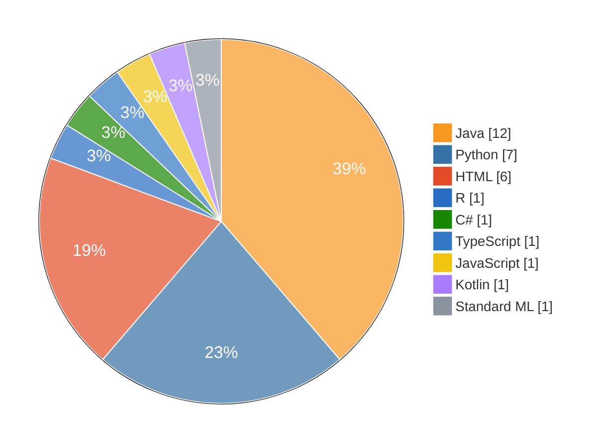
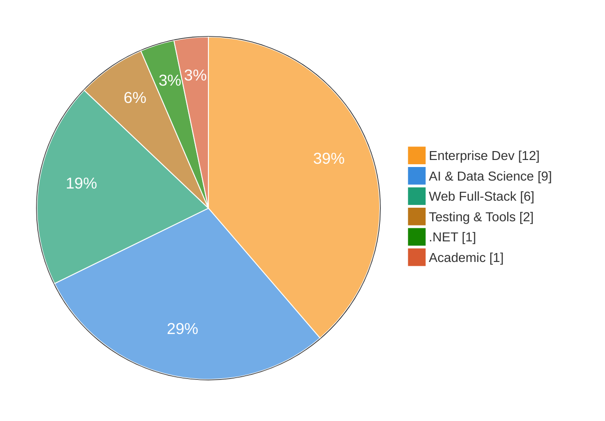

# Perikles Nikoules

**Military Officer — Technical Corps Electrical & Computer Engineer AI Researcher**

Officer by day, builder by passion — software and AI are my craft and my hobby.

---

<h2 align="center">👤 About Me</h2>

I am a **Military Officer in the Technical Corps** of the Hellenic Army with a strong academic foundation in **Electrical and Computer Engineering** from NTUA. I am currently pursuing an **MSc in Artificial Intelligence** at the University of Essex.

My work spans enterprise software development, full-stack web applications, data science, and technology project management — areas where engineering discipline and analytical thinking converge.

<h3 align="center">💼 Areas of Focus</h3>

| Areas of Focus |
|:-:|
| 🤖 **Artificial Intelligence & Machine Learning** neural networks, deep learning, NLP, data science pipelines |
| 🏗️ **Enterprise Software Development** full-stack Java/Spring, REST APIs, microservices |
| 🌐 **Web Development** Angular/TypeScript frontend; Django, Flask, Spring Boot backend |
| 📋 **Technology Leadership** Agile methodologies, project coordination, systems architecture |

---

<h2 align="center">🎓 Education</h2>

| Education |
|:-:|
| 🎓 **MSc Artificial Intelligence** — University of Essex *In progress* · machine learning, neural networks, NLP, data science |
| 🎓 **MEng Electrical & Computer Engineering** — NTUA *Completed* · digital systems, telecommunications, software architecture, algorithms |

<h2 align="center">🏆 Professional Certifications</h2>

| Certifications |
|:-:|
| 🎖️ **Information & Knowledge Management** — NATO |
| 📊 **Project Management** — PMI / Workearly |
| 💻 **Full Stack Web Development** — Coding Factory, AUEB |

---

<h2 align="center">📊 Repository Summary</h2>

<h3 align="center">Primary language per repository</h3>

<h3 align="center">Repositories by domain</h3>

| Domain · Primary language · Repos |
|:-:|
| ☕ **Enterprise Dev** · Java · 12 Spring Boot · Hibernate · REST APIs · Desktop GUI · Networking |
| 🤖 **AI & Data Science** · Python · 9 PyTorch · TensorFlow · Pandas · NLP · Neural networks |
| 🌐 **Web Full-Stack** · Python / TypeScript · 6 Django · Angular · Tailwind · PostgreSQL · REST APIs |
| 🧪 **Testing & Tools** · Java / Kotlin · 2 Selenium WebDriver · Test automation · Utilities |
| 🔷 **.NET** · C# · 1 ASP.NET · Desktop applications |
| 📚 **Academic & Research** · Multiple · 1 NTUA projects · Multi-language implementations |

---

<h2 align="center">🛠️ Technical Skills</h2>

| Self-assessed levels |
|:-:|
| `████████` **Expert** Java / Spring Boot · SQL (MySQL, PostgreSQL) · HTML / CSS · Git / GitHub |
| `██████░░` **Advanced** Python · TensorFlow · PyTorch · C# · TypeScript · JavaScript · Angular · Django · Flask · Docker · Maven |
| `████░░░░` **Intermediate** R · C/C++ · Kotlin · Prolog · SML · CI/CD |

| Stack |
|:-:|
| **Languages** Java · Python · C# · TypeScript · JavaScript · R · C/C++ · Prolog · SML · Kotlin |
| **Frontend** HTML/CSS · Angular · Bootstrap · Tailwind CSS |
| **Backend** Spring Boot · Hibernate/JPA · JAX-RS · Django · Flask |
| **Databases** MySQL · PostgreSQL · SQL Server |
| **DevOps & Tools** Git/GitHub · Docker · Maven · CI/CD |
| **AI & ML** TensorFlow · PyTorch · Scikit-learn · Pandas · NumPy |
| **Testing** Selenium |

---

<h2 align="center">🎯 Featured Projects</h2>

<h3 align="center">🤖 AI, Machine Learning & Data Science</h3>

| |
|:-:|
| **[from-plato-to-transformers](https://github.com/nikouliciousp/from-plato-to-transformers)** Interactive philosophical journey through 5 experiments in neural networks, from ancient Greek philosophy to modern AI *HTML · MIT* |
| **[ai104-sentiment-analysis](https://github.com/nikouliciousp/ai104-sentiment-analysis)** MSc AI — sentiment analysis & topic classification *Python* |
| **[AIPythonProjects](https://github.com/nikouliciousp/AIPythonProjects)** Comprehensive AI & machine learning implementations *Python · PyTorch* |
| **[AG701-Crime-Analysis-California](https://github.com/nikouliciousp/AG701-Crime-Analysis-California)** Statistical analysis & visualisation of a California crime dataset *R* |
| **[nexus_energy_analysis](https://github.com/nikouliciousp/nexus_energy_analysis)** Energy consumption analysis & prediction models *Python · ML* |
| **[neurons_experiment](https://github.com/nikouliciousp/neurons_experiment)** Neural network research and experimentation *HTML* |
| **[relu_experiment](https://github.com/nikouliciousp/relu_experiment)** Activation function research & deep learning experiments *HTML · MIT* |
| **[Data-Probability-Statistics](https://github.com/nikouliciousp/Data-Probability-Statistics)** Statistical analysis, probability, and data processing *HTML* |
| **[IntroPython](https://github.com/nikouliciousp/IntroPython)** Python fundamentals, OOP, and core programming concepts *Python* |

<!--
TELCO (private repo added 2026-11-08) — add a row here once name/description are confirmed.
Note: a private repo link returns 404 for visitors, so list it without a link or make the repo public.
| **<telco-repo-name>** <description> *<stack>* |
-->

<h3 align="center">☕ Java & Enterprise Development</h3>

| |
|:-:|
| **[SchoolWebApp](https://github.com/nikouliciousp/SchoolWebApp)** Full school management system with REST API and web interface *Java · Spring* |
| **[SchoolJaxRsApp](https://github.com/nikouliciousp/SchoolJaxRsApp)** RESTful API backend for school management *Java · JAX-RS* |
| **[SchoolAppHibernate](https://github.com/nikouliciousp/SchoolAppHibernate)** ORM-based persistence layer with JPA *Java · Hibernate* |
| **[MavenSwingSchoolApp](https://github.com/nikouliciousp/MavenSwingSchoolApp)** Desktop application with Maven build management *Java · Maven · Swing* |
| **[SwingStudentsTeachersApp](https://github.com/nikouliciousp/SwingStudentsTeachersApp)** School management desktop app — MVC pattern *Java · Swing* |
| **[JavaSwingDemoProject](https://github.com/nikouliciousp/JavaSwingDemoProject)** GUI desktop application with event-driven design *Java · Swing* |
| **[JavaSwingWDemoProject](https://github.com/nikouliciousp/JavaSwingWDemoProject)** Advanced desktop application with multi-window support *Java · Swing* |
| **[NetProgramming](https://github.com/nikouliciousp/NetProgramming)** Network programming in Java *Java* |
| **[CodingJavaLab](https://github.com/nikouliciousp/CodingJavaLab)** Algorithms, data structures, and programming exercises *Java* |
| **[TestApp](https://github.com/nikouliciousp/TestApp)** Java testing and demonstration applications *Java* |
| **[SimpleDynamicWebApp](https://github.com/nikouliciousp/SimpleDynamicWebApp)** Dynamic web application with Java backend *Java* |
| **[FinalProject](https://github.com/nikouliciousp/FinalProject)** University capstone integration project *Java* |

<h3 align="center">🌐 Web Development — Full Stack</h3>

| |
|:-:|
| **[NewsProjectPython](https://github.com/nikouliciousp/NewsProjectPython)** Full-stack news portal with REST API *Django · PostgreSQL* |
| **[ProfilesAppDJango](https://github.com/nikouliciousp/ProfilesAppDJango)** User profiles and authentication management system *Django* |
| **[EBookAppDJango](https://github.com/nikouliciousp/EBookAppDJango)** E-book platform and digital library management *Django · Python* |
| **[IntroAngularTailwind](https://github.com/nikouliciousp/IntroAngularTailwind)** Modern SPA with Angular and Tailwind CSS *Angular · Tailwind* |
| **[IntroTypeScript](https://github.com/nikouliciousp/IntroTypeScript)** Angular and TypeScript best practices *Angular · TypeScript* |
| **[WebApp-Flex-Grid](https://github.com/nikouliciousp/WebApp-Flex-Grid)** Responsive CSS layout — Flexbox and Grid *HTML5 · CSS3* |

<h3 align="center">🔷 .NET, Testing & Academic</h3>

| |
|:-:|
| **[CFHCSharpIntro](https://github.com/nikouliciousp/CFHCSharpIntro)** C# programming fundamentals and OOP *C# · .NET* |
| **[Selenium_Test](https://github.com/nikouliciousp/Selenium_Test)** Automated browser testing framework *Selenium* |
| **[swot](https://github.com/nikouliciousp/swot)** Academic email domain identifier utility (fork of JetBrains/swot) *Kotlin* |
| **[NTUA-Projects](https://github.com/nikouliciousp/NTUA-Projects)** Academic projects from NTUA with multi-language implementations *Standard ML · Java · Python · C++* |

---

<h2 align="center">🎯 Current Focus</h2>

| Focus |
|:-:|
| 🤖 **Advanced AI & Deep Learning** neural networks, NLP, computer vision (MSc at University of Essex) |
| 📊 **Engineering Leadership** Agile practices, team coordination, strategic planning & architecture |
| 🎓 **Technical Mentoring** system design, clean code, SOLID, design patterns |

---

<h2 align="center">📞 Contact & Connect</h2>

*Build with discipline. Learn with curiosity. Improve continuously.*

**Last updated: November 2026**

